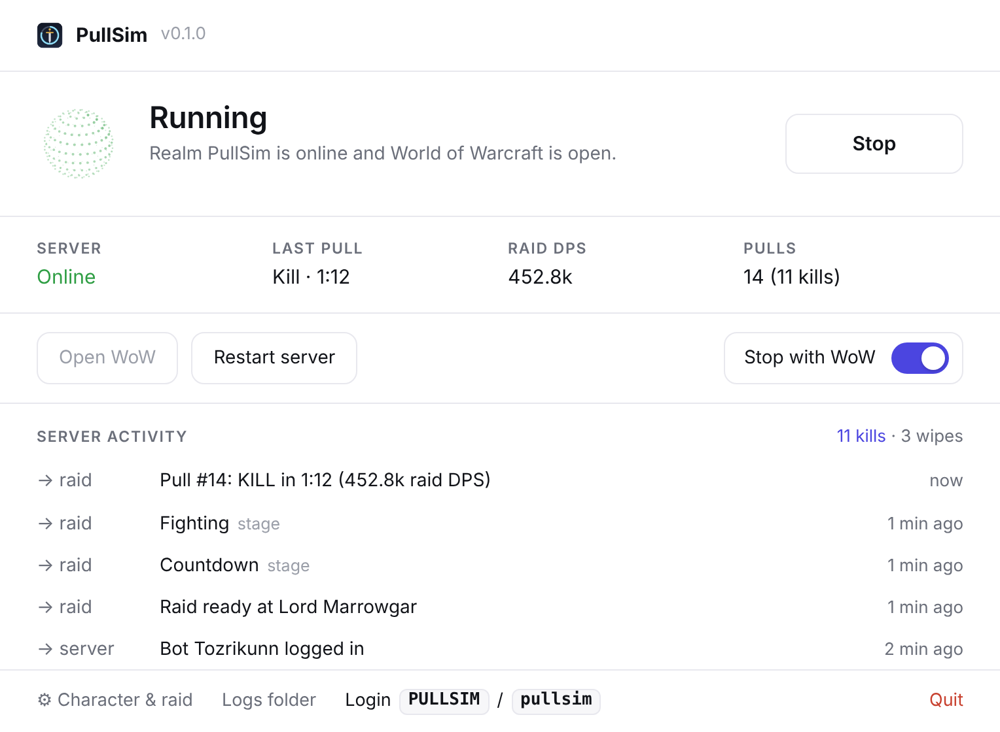
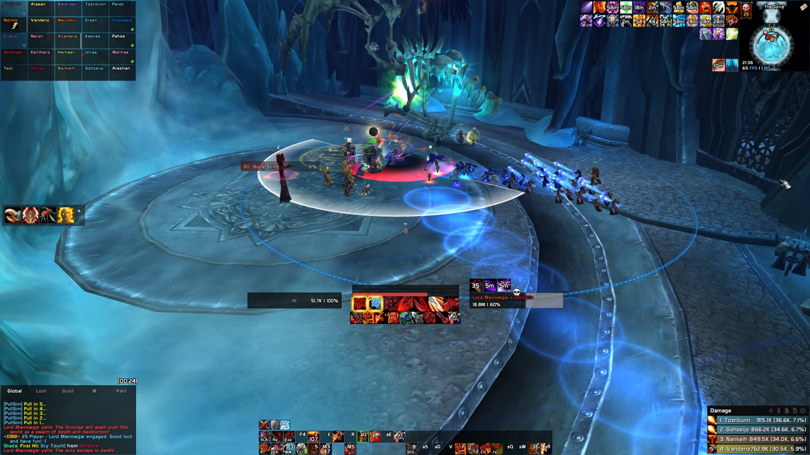
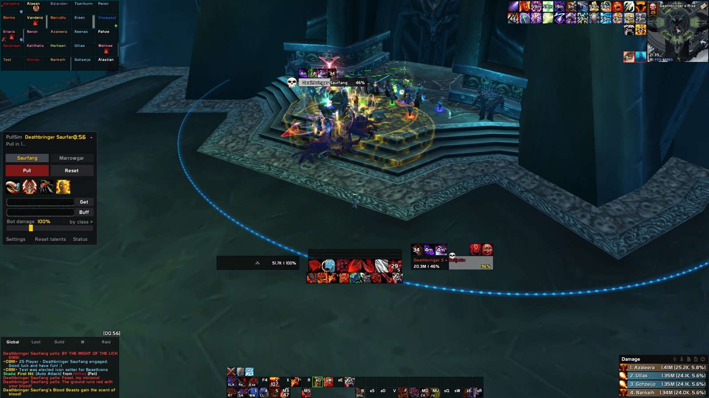
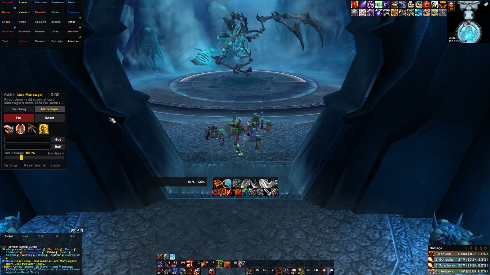

# PullSim

**Icecrown Citadel boss practice, on repeat.** A one-click, offline World of Warcraft 3.3.5a raid simulator: you plus
24 bots that play like a real raid (Phase 5 best-in-slot gear, real rotations, consumables and cooldowns) on
**Lord Marrowgar** and **Deathbringer Saurfang**. Pull, reset, pull again, as many times as you want.

| Lord Marrowgar | Deathbringer Saurfang |
|---|---|
|  |  |

 
The raid waiting at Marrowgar's room, with the in-game PullSim panel on the left.

## Download and play

1. Download **PullSim.exe** from the [latest release](../../releases/latest).
2. Put it in your **World of Warcraft 3.3.5a** folder, next to `Wow.exe`.
3. Scroll down and choose the existing character you want to copy macros/keybinds/savedvariables from your real server - also choose raid composition here, keep 2 tanks and sort healers and dps class/specs as you want.
4. Run it and press **Start & Play**.
5. When WoW opens, log in with **PULLSIM / pullsim**, create a character of the class shown under
   *Character & raid* (any race) and enter the world. PullSim levels it to 80, applies talents, glyphs and gear,
   and builds your raid.

The **first start takes a while** (roughly 15–20 minutes, only once): PullSim downloads the server package, reads
the maps from *your* WoW client and creates the database. After that it starts in about 20 seconds everytime.

Nothing is installed system-wide. Everything lives in a `PullSim` folder next to the exe, and your
`realmlist.wtf` / `Config.wtf` are put back when PullSim stops. That means to play back on your normal server you just open wow like you always did. There is 0 manual work.

**Requirements:** Windows 10 or 11 (64-bit), a 3.3.5a (12340) client, about 6 GB of free disk space, and
Microsoft Edge or Google Chrome (used to draw the PullSim window).

## The PullSim window

- **Start & Play** starts the server and opens WoW; **Stop** shuts the server down.
- **Open WoW**, **Restart server**, **Stop with WoW** (stop the server when you close the game).
- **Character & raid**: your class, spec and gear options, copying your keybinds, macros and UI from one of your own
  characters, raid size, and the raid composition (auto-built from the number of tanks and healers, or picked bot by bot).
- **Server activity** shows what the server is doing; **Logs folder** opens the logs if something goes wrong.

## In game

The **PullSim panel** (top of the screen, drag to move):

- **Marrowgar / Saurfang**: switch boss; the raid is teleported.
- **Pull**: countdown, then the boss engages. `/dbm pull 10` (DBM or BigWigs pull timers) works too.
- **Reset**: revive everyone, refresh cooldowns and buffs, reset the boss. Works while dead.
- **Buff icons**: Battle Squawk, Hysteria, Tricks of the Trade and Power Infusion on yourself, only when you click them.
- **Item box**: any item by name, id or shift-clicked link. **Buff box**: any buff by name, spell id or link.
- **Bot damage**: scale the bots' damage (25–300%); **by class >** opens one slider per class, kept per boss. Default settings already mimic a good endgame raid - don't worry about the bots damage, they are there merely to give you a raid experience, play mechanics and give you the kill times you want).
- **Settings**: difficulty, pull timer, auto reset, ICC zone buff, Saurfang intro, raid buffs, flasks, debuffs,
  Bloodlust, damage taken, bot healing, infinite healer mana and fixed positions.

The addon panel shrinks to the buff icons during a pull.

## Updating

Download the new **PullSim.exe** from the latest release and replace the old one. PullSim updates its server
package by itself when a new one is published; your characters, settings and pull history are kept.

## Uninstalling

Close PullSim (red **Quit**), then delete `PullSim.exe` and the `PullSim` folder from your WoW folder (and
`Interface\AddOns\PullSim` if it is still there).
